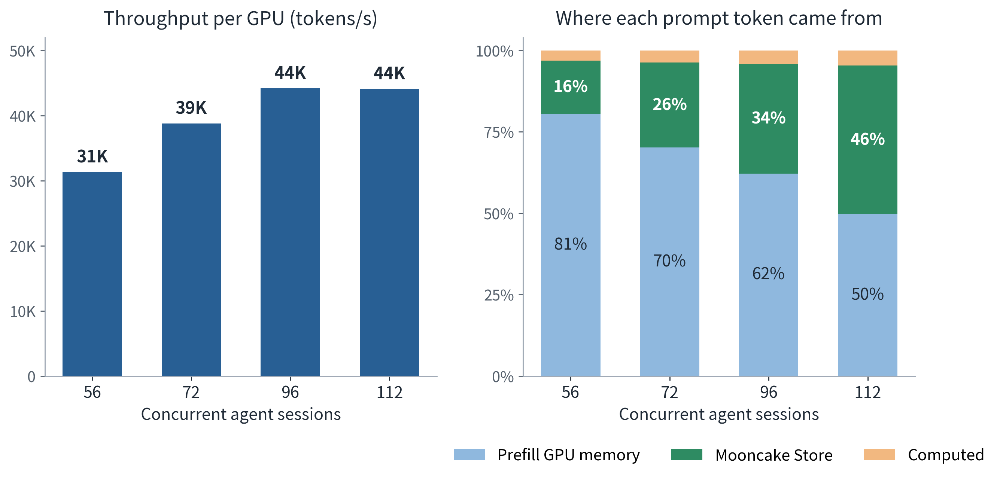

# ATOM Meets Mooncake: A Shared KV Pool for Agentic Serving on AMD Instinct GPUs

[中文版](./README.zh-CN.md)

## Introduction

A coding agent rarely asks a new question. It sends the same long conversation back with a little more at the end. As agentic coding becomes everyday work, serving it means long sessions that pause for tools and come back expecting the server to still hold their history. SemiAnalysis now measures this workload with [InferenceX AgentX](https://github.com/SemiAnalysisAI/agentx-harness).

We serve it with prefill and decode on separate GPUs, which keeps long prefills from stalling the agents that are generating. The split has a side effect that is easy to miss: it splits the server's host memory in two as well, and the half next to decode sits nearly idle. **Mooncake Store pools both halves back into one KV pool.** With it, ATOM serves around a hundred concurrent agent sessions on one 8-GPU AMD Instinct MI355X server at about 44K tokens/s per GPU, and reuses more than 95% of every prompt.

## One Agent Session, Up Close

Figure 1. One session from the public AgentX trace: requests and waits (top), live KV per thread (bottom).

AgentX replays recorded Claude Code sessions against a live server. Figure 1 follows one of them, session `ebaea288` from the public [`cc-traces-weka-062126`](https://huggingface.co/datasets/semianalysisai/cc-traces-weka-062126) corpus, chosen because its 65 main-thread requests match the corpus median. Over almost two hours, the main thread's context grows from 40K to 173K tokens, and at one point the agent fans out four subagents in parallel. Times are as recorded with the original model; the one long pause, 87 minutes, is drawn as 300 seconds, the cap AgentX replay applies.

Three things in this picture decide how the server must treat KV.

**The history is almost all reused.** Each request resends the same conversation with a little added at the end. Across the trace, the median request carries 142K input tokens, and with a perfect prefix cache only **1.7K** of them need prefill. Whether a turn computes 1.7K tokens or 142K depends on one thing: whether the server still holds the history as KV. Some turns no cache can save: after the long pause in Figure 1, most of the next prompt is new (hatched).

**The history is heavy.** GLM-5.3 with an FP8 KV cache stores 48,672 bytes per token, so a 100K-token conversation takes about 5 GB.

**The history spends most of its life waiting.** The amber and light-green blocks in the top panel are time when the main thread has no request running, because a tool, the user or its subagents are working. During the 182-second wait marked in Figure 1, 7.2 GB of KV has nothing to do, but the next turn needs all of it. When the four subagents run, each builds its own context, and the session's live KV jumps to 26 GB. The server therefore has to hold the history of every live session, not only of the requests running right now.

## Why GPU Memory Is Not Enough, and Why Disaggregation Makes It Worse

Figure 2. The history behind the 182-second wait in Figure 1, without (A) and with (B) a shared KV pool; schematic.

When the 182-second wait in Figure 1 ends, the main thread sends 147,904 tokens, 146,944 of which it has sent before. If the history survived the wait, prefill computes 960 tokens. If not, it computes all of them (Figure 2, panel A).

One session fits easily; every live session at once does not. By our estimate, each live session holds about 10 GiB of history that a later turn will reuse, counting its main thread and running subagents, so around a hundred sessions need about 1 TiB. The four prefill GPUs have about 0.4 TiB left for KV after the model weights. Under load, other sessions' KV fills that space, the waiting history is evicted, and the next turn prefills it again.

Host DRAM has the room, but disaggregation splits it. Each half of the server has its own NUMA node, and prefill and decode each take one. A CPU cache attached to prefill sees only prefill's half. The decode half has as much DRAM again, and almost none of it holds history, because decode keeps its working KV in GPU memory. The capacity exists, but on the wrong side of the split.

**So we pool both halves into one KV pool that prefill can save to and restore from** (panel B). The history is saved there during the wait and restored for the next request, which then computes only its new tokens. That raises two new problems. A hit in DRAM is not yet a hit in prefill: the history has to reach the prefill GPUs, in prefill's layout, before the request can start. And every request's KV still has to cross from prefill to decode before its first token. We set three goals:

- Keep far more agent history than GPU memory can hold.
- Turn a pool hit into a prefill hit, safely and before the request needs it.
- Hand each request's KV to decode as fast as prefill produces it.

## ATOM + Mooncake: Two KV Paths

Figure 3. ATOM with Mooncake Store and Mooncake Transfer Engine on AMD Instinct MI355X.

**ATOM** is AMD's open-source inference engine for Instinct GPUs, built on ROCm and the AITER kernel library. On this server, ATOM runs one prefill instance on the four GPUs of one NUMA node and one decode instance on the other four, with ATOM's router in front. Prefill splits the model by layers: each GPU runs about a quarter of the layers, as one stage of a pipeline. Decode splits each sequence by tokens: each GPU holds every fourth token, for all layers.

When a turn arrives, prefill reuses the longest prefix still in its GPU memory and loads the part beyond it from **Mooncake Store**, over RDMA straight into GPU memory. It computes only the tokens that neither tier holds and saves the new KV to the Store, for the session's next turn. The router then hands the request to decode, **Mooncake Transfer Engine** carries its KV from the prefill GPUs to the decode GPUs, and decode generates the answer.

The two Mooncake components handle KV with different lifetimes. Transfer Engine moves KV that a request needs now. Mooncake Store keeps KV that a session will need later, after the request that produced it has finished, and decode never reads it. **ATOM decides which KV is reusable and when it is safe to use; Mooncake decides where it lives and how it moves.**

Mooncake Store separates the services that provide memory from the clients that use it, which suits a disaggregated server. We run one Store service per NUMA node, each contributing 768 GiB of DRAM, plus a Mooncake Master that tracks where objects live and evicts the least recently used ones when the pool is 90% full. Only the prefill GPUs read and write the pool, yet decode's NUMA node supplies half of it. The result is a 1.5 TiB KV pool, nearly four times the KV space of the prefill GPUs, built from memory that would otherwise sit idle. The same design scales out across servers: Store services on each added server join the same Master, so the pool grows with every server, and prefill GPUs read and write it over RDMA just as they do here.

The pool also needed huge pages. All of its memory is registered with the RDMA NICs, and registration fails if any part of a region falls back to 4 KiB pages. Transparent huge pages could not guarantee that on busy hosts, so we reserve huge pages before the Store services start.

## From a Pool Hit to the First Token

Capacity is the easy part. A pool hit saves work only if all four prefill GPUs have their share before the request starts, and the handoff to decode has to keep pace with prefill.

### Stage-Aligned Restore: Turning a Pool Hit into a Prefill Hit

Figure 4. Three things between a DRAM hit and a prefill hit; schematic.

Figure 4 opens up the green restore arrow of Figure 2. The history is **far**: it can sit in either half's DRAM and must cross the network into GPU memory. It is **packed**: the pool holds plain bytes, which must be unpacked into the paged KV that attention reads. And it is **all or nothing**: prefill is split by layers, so a prefix is usable only when every stage has its layers.

ATOM stores KV the way prefill is split. Each pipeline stage saves its own layers of each 256-token chunk as a separate Store object, and a prefix counts as a hit only as far as all four stages hold it. Mooncake keeps a chunk's four objects in one group and evicts them together, so eviction never leaves a chunk that only some stages can load. Small chunks also mean that a turn that changes its history partway through still reuses everything up to the last 256-token boundary before the change.

Each prefill GPU registers one buffer with Mooncake. KV moves between that buffer and Store DRAM over RDMA, and the GPU packs and unpacks it itself, so no CPU copy sits on the path. A request that needs Store data waits until every stage has its part, while other requests keep running.

### Handing KV to Decode in Large Writes

Figure 5. Prefill-to-decode KV handoff: gather on prefill, large RDMA writes, scatter on decode.

Prefill (pipeline parallelism, PP4) and decode (tensor parallelism with decode context parallelism, TP4 + DCP4) keep KV in different layouts: a prefill GPU holds every token for its own layers, while a decode GPU holds every fourth token for all layers. A direct copy therefore becomes one tiny write per token per layer. For one 8,192-token chunk of one 20-layer stage, that is 163,840 writes of 576 bytes each, and posting them, not the network, becomes the bottleneck.

ATOM instead gathers the KV bound for each decode GPU into contiguous buffers on the prefill GPU. Mooncake Transfer Engine moves each buffer in RDMA writes of up to 8 MiB into a landing buffer on the decode GPU, and decode scatters it into its KV pages. The same chunk, about 94 MB, now takes **12 writes**.

The trade is GPU work and memory for far fewer network operations. Gather and scatter run on the GPUs, the staging and landing buffers take GPU memory that could otherwise hold KV, and a request is ready for decode only after its scatter finishes.

## Results: Mooncake Store Carries the Reuse as Sessions Grow

Figure 6. Throughput per GPU, and where each prompt token came from, at 56 to 112 concurrent sessions.

We ran InferenceX AgentX against this deployment for an hour at each load, from 56 to 112 concurrent agent sessions, in [one InferenceX sweep](https://github.com/SemiAnalysisAI/InferenceX/pull/4045). The sweep measured GLM-5.2, which has the same architecture and KV size per token as GLM-5.3. It runs with MXFP4 weights, an FP8 KV cache and multi-token prediction, with the draft acceptance length pinned to the value InferenceX prescribes. Throughput per GPU counts every prompt token, cached or not, plus generated tokens, divided by all eight GPUs.

**Throughput.** Throughput per GPU rises from about 31K tokens/s at 56 sessions to about **44K** at 96 and 112 sessions, where the median generation speed per user is about 46 tokens/s.

**Where the prompt tokens come from.** Reuse stays high because Mooncake Store picks up what GPU memory can no longer keep. At 56 sessions, prefill GPU memory serves 81% of prompt tokens and the Store 16%. As sessions grow, GPU memory's share shrinks and the Store's grows, to **46%** of all prompt tokens at 112 sessions. Total reuse stays above 95% at every load, close to the 96–97% that the traces allow.

**What the Store saves.** If the Store's share had to be computed instead, prefill at 112 sessions would compute about half of all prompt tokens rather than 4.6%, roughly **11 times** the prefill work; at 96 sessions, about 9 times. This is an estimate from the measured shares, not a run without the Store.

**How fast a restore is.** A typical restore brings back 110K–130K tokens of history. Each prefill GPU reads and unpacks its share in a median of 150–220 ms. Because the four stages do not load at the same moment, a request waits on average **0.4–1.2 s** from its first stage starting to its last stage finishing, rising with load. No load failed in any of the measured runs. At 112 sessions, Mooncake moved about 66 TB of KV per hour inside the server, between the Store and prefill and from prefill to decode.

**Where it stops.** Up to 96 sessions, median time to first token stays at 2.5 s or below. At 112 sessions throughput still holds at 44K, but the server has run out of headroom: decode's KV memory is a median **91%** full, requests start to queue in front of prefill, and median time to first token reaches about 7 s.

## Future Work

ATOM with Mooncake now keeps agent history within reach on one server, but there is room to go further.

**Sharing one pool across servers.** Scaling the pool out as described above widens reuse, at the cost of cross-server traffic and larger failure domains; measuring that trade-off on multi-server deployments is next.

**Adding an SSD tier.** Some agent sessions pause for many minutes. [Mooncake's SSD offloading](https://kvcache.ai/blog/scaling-kv-cache-beyond-memory/) could keep their history at a fraction of the cost of DRAM.

**Making room on decode.** Decode keeps each running request's KV in GPU memory, which was nearly full at the highest load. More decode GPUs per prefill instance and more KV per decode GPU are next.

## Acknowledgments

We thank the Mooncake community for Mooncake Store and Transfer Engine and for working with us on this deployment, SemiAnalysis for AgentX and InferenceX, and AMD's ATOM, AITER, FlyDSL, and ROCm teams for the serving engine, kernels, and software this work builds on. ATOM's Mooncake Store connector ([ROCm/ATOM#2464](https://github.com/ROCm/ATOM/pull/2464)) and its prefill-to-decode transfer path ([ROCm/ATOM#2431](https://github.com/ROCm/ATOM/pull/2431)) are open source.

## Related Links

- ATOM: https://github.com/ROCm/ATOM
- Mooncake project: https://github.com/kvcache-ai/Mooncake
- AgentX benchmark: https://github.com/SemiAnalysisAI/agentx-harness
- AgentX trace corpus: https://huggingface.co/datasets/semianalysisai/cc-traces-weka-062126
- InferenceX results for this deployment: https://github.com/SemiAnalysisAI/InferenceX/pull/4045
